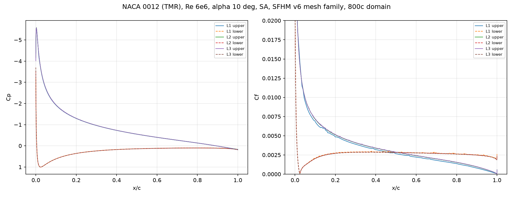

# mantle

**Shell-first hybrid meshing for CFD: wrap the body in its boundary-layer shell first, then mesh everything else.**

mantle is an open-source mesh generator for viscous CFD (OpenFOAM and SU2). The goal is to match what established meshers already do, and also to handle cases where they fail or give up:

- y+ ≈ 1 boundary layers that do not collapse;
- layers that survive sharp edges, narrow gaps and dirty geometry;
- one mesh that runs in both OpenFOAM and SU2.

> **Status: research prototype.** The 2D method is validated against snappyHexMesh, Gmsh and NASA reference data (numbers below). The 3D core (Rust) builds valid wall-resolved meshes on smooth and sharp-edged bodies, but does **not** yet handle concave junctions (see [Limitations](#limitations)). Not production-ready.

---

## Why another mesher?

Every widely used automatic mesher builds the boundary layer **last**: snappyHexMesh, cfMesh, Gmsh, Pointwise T-Rex, Fluent Mosaic, STAR-CCM+. They first make a volume mesh that fits the wall, then push layers outward from the wall into it. That ordering is where most meshing pain comes from:

- **Layers collapse or are dropped:** at sharp convex edges, in concave corners, in gaps narrower than the layer stack, and whenever the first cell is very thin (y+ ≈ 1).
- **Dirty CAD needs a separate repair step** (wrapping, healing) before anything can be meshed.
- **Results depend on hand-tuned quality switches.** Typical examples are layer collapse/shrink tolerances and feature-snap iterations, and they often have to be changed per geometry.

**mantle reverses the order.** It first builds the outer surface of the boundary layer, the *shell*: a smooth offset of the wall at the layer thickness δ, constructed so it is closed and does not intersect itself. Then it:
1. meshes the bulk up to that smooth shell, which is easy because the shell has no sharp features;
2. fills the gap between shell and wall with layer columns.

The layers are never pushed into an existing mesh, so there is nothing for them to collide with.

## What we aim to do that standard meshers can't

| Capability | Typical behaviour of existing tools | mantle (status) |
|---|---|---|
| y+ ≈ 1 layers that don't collapse | snappyHexMesh: **0 % layers** at y+ ≈ 1 with default quality settings in our test; relaxed settings gave an invalid mesh at the next refinement level | 100 % of first cells on spec, every level (2D ✅; 3D ✅ smooth and sharp-edged bodies, ❌ concave junctions) |
| Layers on sharp convex edges and corners | Usually collapsed or dropped at the edge | Automatic layer **fans** (prisms/pyramids in 3D) (2D ✅, 3D ✅) |
| Gaps narrower than the layer stack | Layers collapse or intersect | A shell safety net detects the collision and thins δ locally, so layers survive (2D ✅) |
| Dirty geometry (holes, folds, zero-width slivers, overlapping parts) | Needs a wrapper or repair step | Inside/outside from winding numbers plus exact, **reported** repairs; leaks are detected, not silently meshed through (2D ✅; 3D inside/outside ✅) |
| One mesh for OpenFOAM **and** SU2 | Usually tied to one ecosystem | Native polyMesh plus native `.su2`, checked with checkMesh and SU2_CFD (✅) |
| Very large far-field domains | Expensive (snappy refines a 3D slab even for 2D cases) | Octree coarsening makes an 800-chord domain nearly free (✅) |
| Speed | Minutes for snappy; seconds for Gmsh in 2D | Rust core; GPU-ready "tri-dexel" geometry sampling (✅ partial; the 2D prototype is still Python) |
| Spec-driven meshing (target y+, layers, cell budget) | Manual tuning | First-cell height enforced per layer column; ML-predicted sizing planned ([docs/ML_SIZING_SPEC_v1.md](docs/ML_SIZING_SPEC_v1.md)) |

## How it works

```
triangle soup (dirty STL ok)
   │  tri-dexel rays + fast generalized winding numbers ─► inside/outside, exact surface crossings
   ▼
shell Γ = offset of the wall at δ(x)
   │  eikonal shell (2D) / exact closest-point offset (3D); safety net: one shell per body, no wall crossing
   ▼
bulk = 2:1-balanced octree (quadtree in 2D) outside the shell
   │  3D: hex core + one pillow layer projected onto the shell, Jacobian-optimised
   ▼
layers = columns from the shell down to the wall
   │  2D: harmonic streamlines; 3D: nearest-wall-point columns; geometric growth, per-column first cell = spec,
   │  fans at convex features
   ▼
OpenFOAM polyMesh  +  SU2 native mesh
```

## Measured results (2D prototype)

All numbers were measured in this repo with identical specs for every mesher; the scripts are listed further down.

### y+ ≈ 1 against snappyHexMesh

NASA TMR NACA 0012, Re 6e6, α 10°, SST, level L1, 100-chord domain.

| | mantle | snappyHexMesh (default) | snappyHexMesh (relaxed quality) |
|---|---|---|---|
| First cells on spec | **100 %** | 0 % (all layers collapsed) | 85.5 % |
| Cl / Cd | **1.059 / 0.0145** | n/a | 1.029 / 0.0197 |
| Cells | 19.2k | 21.2k | 28.8k |
| Mesh time | ~25 s (Python) | ~4 min | ~4 min |
| Next level (L2) | valid | 0 % layers | **invalid mesh** (negative volumes, solver crash) |

### Against Gmsh

Same SU2 solver and settings (official SU2 NACA 0012 SA configuration, converged to 1e-12). Mach 0.15, Re 6e6, α 10°.

| | Gmsh L1 | **mantle L1** | Gmsh L2 | **mantle L2** | NASA SA (7 codes) |
|---|---|---|---|---|---|
| Cl | 1.0254 | **1.0544** | 1.0712 | **1.0832** | 1.089–1.100 |
| Cd | 0.02564 | **0.01763** | 0.01733 | **0.01397** | 0.0123–0.0125 |
| Elements | 18.6k | 22.7k | 46.2k | 56.2k | |
| Mesh time | **1.3 s** | ~10 s | **3.2 s** | 40 s | |
| Min angle | **24°** | 4.9° | **27°** | 4.4° | |

At equal refinement mantle is closer to the reference. Gmsh is faster and has better minimum angles; we are fixing both.

### Grid convergence

SA model, OpenFOAM, 800-chord domain, three levels.

- Cl: 1.0691 → 1.0777 → 1.0787. Cd: 0.01366 → 0.01291 → 0.01280.
- Observed order is about 3. GCI is 0.16 % (Cd) and 0.02 % (Cl).
- Extrapolated Cl, corrected to Mach 0.15, is 1.091, inside the NASA band. Cd is 3–4 % above it, and that gap is not mesh error.



### Dirty geometry and gaps

The test geometry is an airfoil with a hole, a back-tracking fold and a zero-width spike.

- mantle reports and repairs these exactly (4 cancelled segment pairs, 1 hole bridged). The result is the same mesh, 0 hard checkMesh failures and identical Cl/Cd as the clean airfoil.
- snappyHexMesh meshes through the hole into the body.

| mantle (hole bridged) | snappyHexMesh (leaks through the hole) |
|---|---|
|  |  |

| mantle, two-element gap | snappyHexMesh, two-element gap |
|---|---|
|  |  |

(2D figures are from the v1 prototype.)

## 3D status (Rust core, `rcore/`)

Test bodies: sphere, sphere ∪ torus (intersecting, i.e. a dirty soup), and a sharp-edged cube. All at octree level 7, 16 CPU threads.

| Stage | Result |
|---|---|
| Inside/outside of 16.8M grid nodes on a 21k-triangle dirty soup | 0.26 s CPU (tri-dexel + fast winding fallback); 0.125 s GPU; 100 % agreement with exact winding numbers |
| Octree, 14.4M leaves, strict 2:1 balance | 24 s; 0 balance violations; exact surface crossings to 1e-16 |
| Hex core + pillow layer on the shell | Min scaled Jacobian 0.50 / 0.37 / 0.50; 0 cells below 0.2; default `checkMesh` reports "Mesh OK"; SU2 loads clean |
| Boundary layers (12 layers) | Sphere and cube: 0 inverted cells, first cell on spec, prism/pyramid fans at the cube edges, "Mesh OK". SA RANS smoke test in SU2 converges 1e-5 → 1e-8 in 300 iterations |

### Limitations

- **Concave junctions are not handled yet.** Where two bodies meet (the sphere ∪ torus crease) the 3D layer columns twist, giving 115 inverted cells out of 245k. Fixing this is the top priority. Real geometry is full of such junctions, for example wing roots.
- **2D speed and angles:** the 2D prototype is pure Python, and its minimum angles in the SU2 export are worse than Gmsh's.
- **Not yet benchmarked in 3D:** no 3D benchmark against Gmsh, snappyHexMesh or cfMesh yet, and no 3D force validation.
- **Strict checks flag a known artefact:** OpenFOAM's optional `-allGeometry` check flags 2:1 octree transition cells as "concave". This is a round-off effect on exactly coplanar faces, and snappyHexMesh meshes show the same flag.

## Roadmap

1. 3D layers at concave junctions: streamline/harmonic column directions (the method that solved this in 2D) plus local stack reduction.
2. 3D validation: sphere and 3D wing at y+ ≈ 1 against snappyHexMesh, cfMesh and Gmsh, plus experimental data.
3. Variable δ(x) shell in 3D (eikonal) and the topological validity oracle.
4. Conforming 2:1 templates (an all-hex core); parallel optimiser; Python bindings (PyO3).
5. ML sizing: predict δ(x), first-cell height and layer count from geometry plus Re/Ma, with a verify loop ([spec](docs/ML_SIZING_SPEC_v1.md)).

## Repository layout

| Path | Contents |
|---|---|
| `rcore/` | Rust core, std only, no dependencies: `dexel` (tri-dexel sampling), `fwn` (fast winding numbers, 3rd order), `bvh` (closest point, segment hits), `octree` (size field, 2:1 balance, cut data), `hexcore` (hex core + pillow + optimiser), `layers` (3D boundary layers), `cutmesh` (cut-cell variant), `foam` / `su2` writers. Benchmarks are in `src/bin/`. |
| `proto2d/` | 2D prototype (`sfhm2d_v1.py` … `v7`, each version kept), plus the comparison harnesses (snappy, Gmsh, SU2, OpenFOAM), Cp/Cf plotting, and 3D test harnesses. |
| `RESEARCH_volume_meshing_v1.md`, `RESEARCH_literature_v2.md` | Literature review, method design and novelty check. |
| `mesh_handover.md` | Detailed development log and current state. |
| `docs/` | The ML sizing specification and the figures. |

## Quick start

```bash
# Rust core
cd rcore && cargo test --release && cargo build --release

# 2D prototype (Python 3, numpy, scipy, matplotlib)
python3 proto2d/sfhm2d_v7.py --geom twoelement --out runs/twoelement --plot --su2

# 3D hex core + boundary layers (input: little-endian triangle soup, see rcore/src/bin/hexcore_bench.rs)
rcore/target/release/hexcore_bench soup.bin origin=-1.5,-1.5,-1.5 size=3.2 L=7 h_surf=0.025 grade=0.25 \
    h_max=0.4 delta=0.1 layers=12 dy0=1.8e-3 growth=1.25 out_dir
```

OpenFOAM v2512 and SU2 v8.5 were used for validation. Gmsh 4.15 and snappyHexMesh were used as baselines.

## License

[Apache-2.0](LICENSE)
