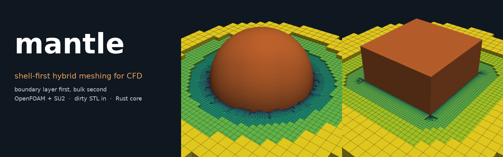
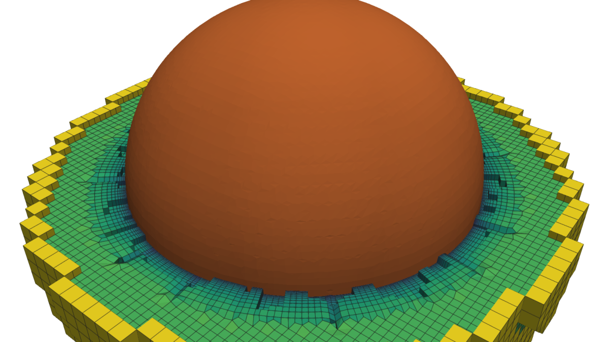
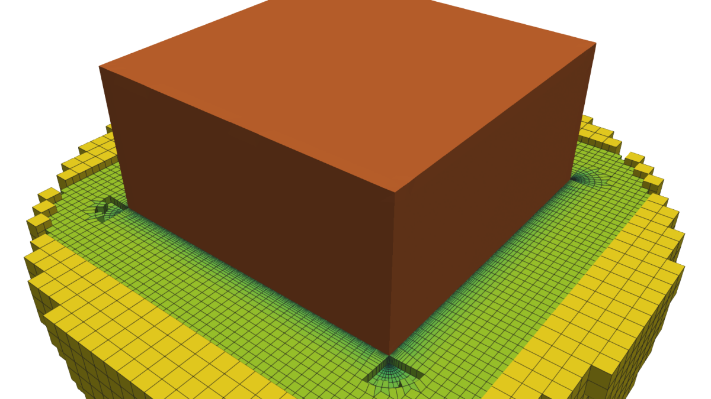
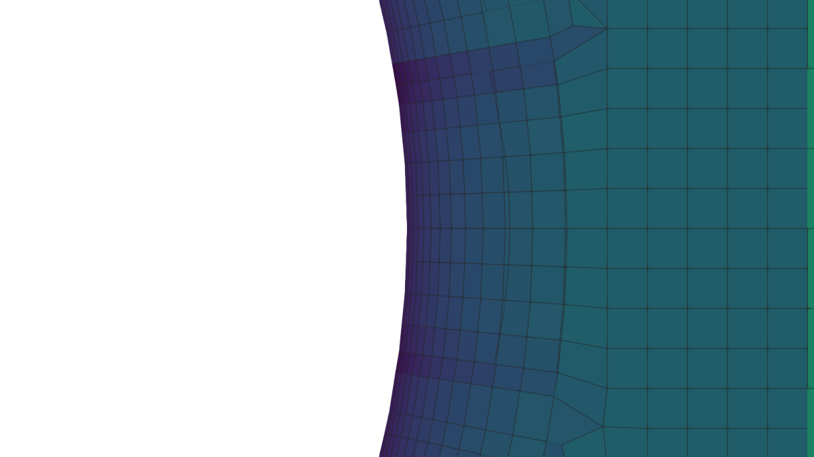
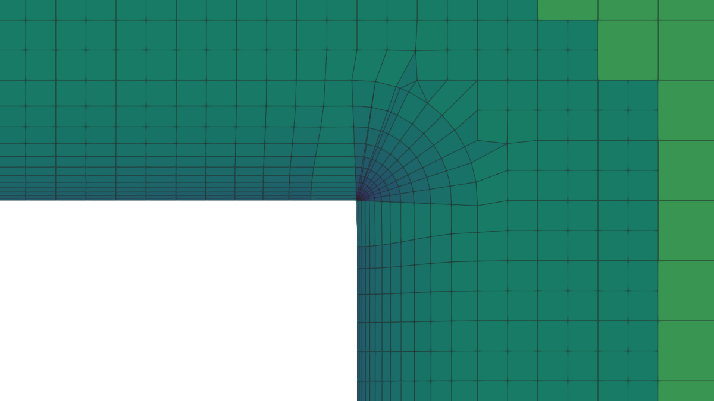
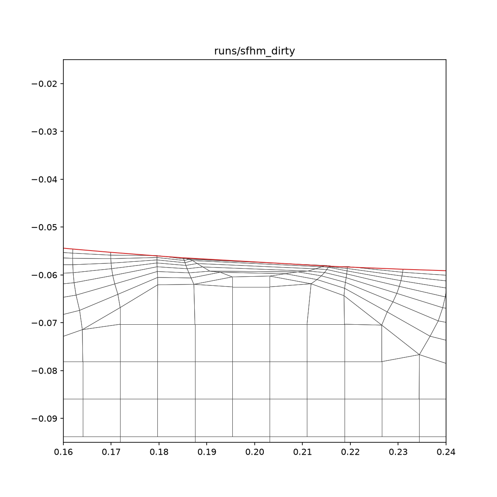
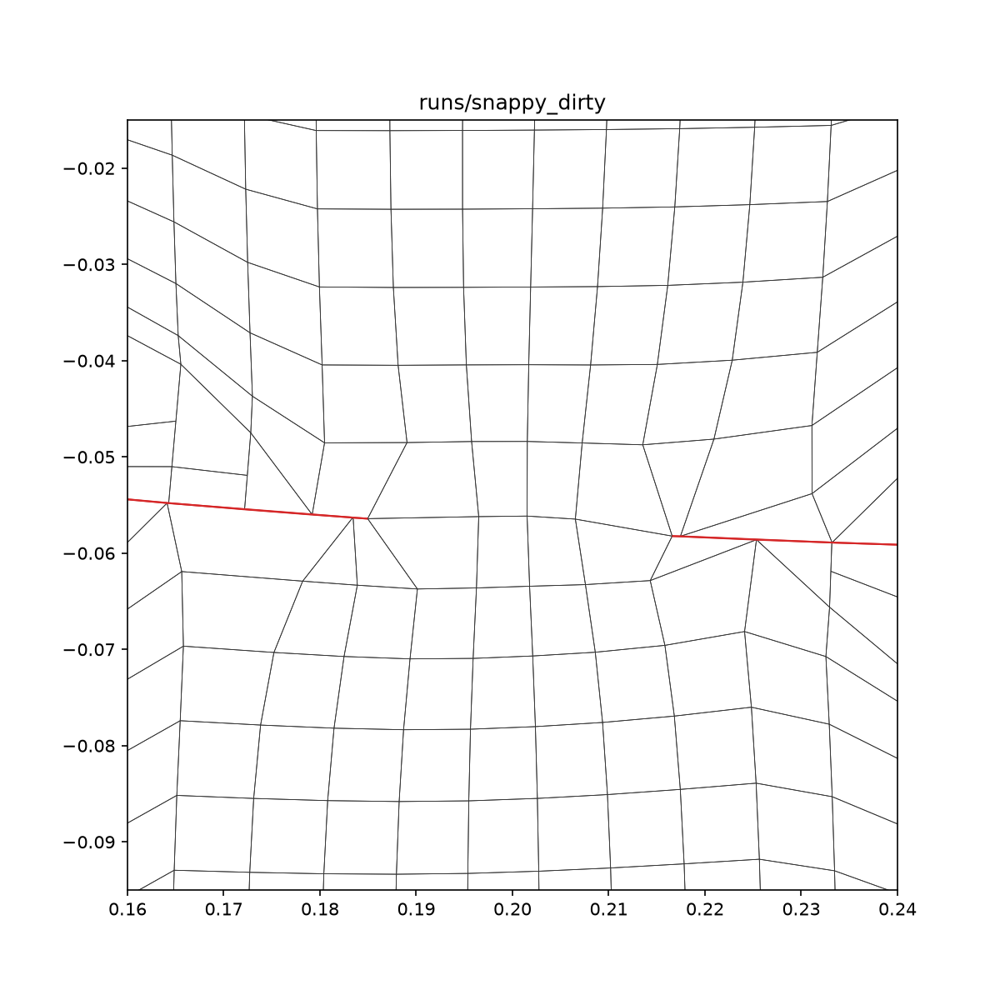
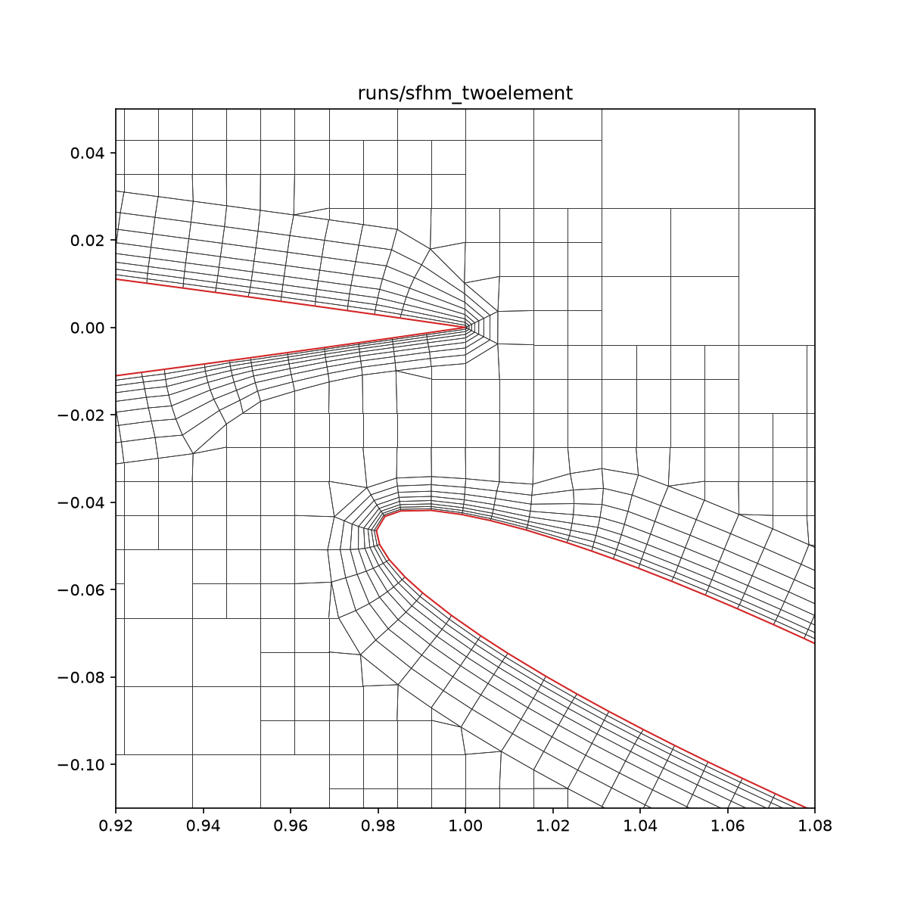
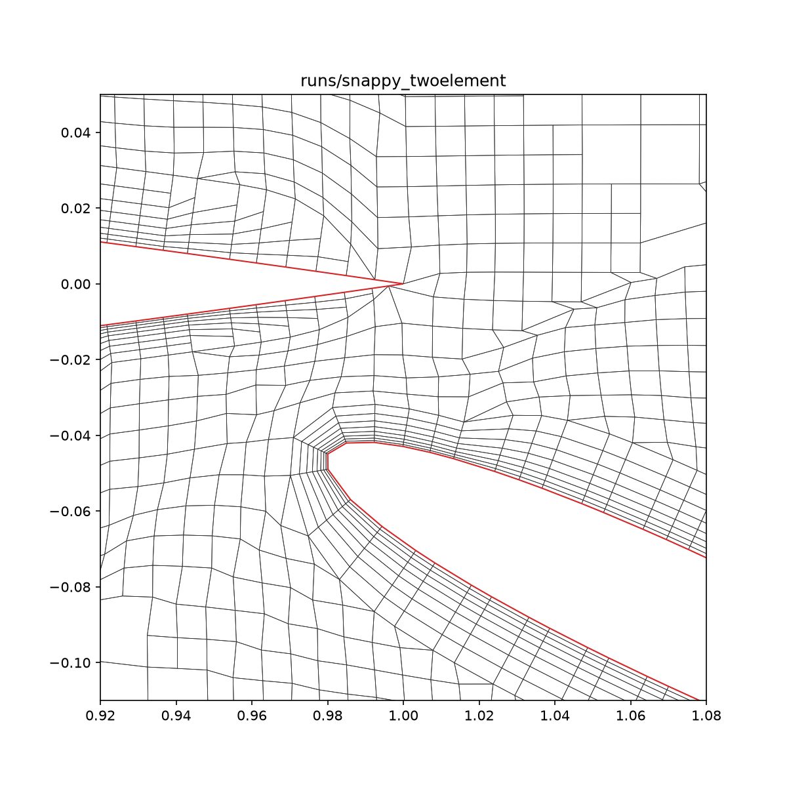

<div align="center">



**Wrap the body in its boundary-layer shell first, then mesh everything else.**

[](https://github.com/Syphonicc/mantle/actions/workflows/ci.yml)
[](LICENSE)
[-b7410e.svg)](rcore/)
[](https://www.openfoam.com/)
[](https://su2code.github.io/)
[](#limitations)
[](CONTRIBUTING.md)

[Quick start](#quick-start) · [How it works](#how-it-works) · [Results](#measured-results-2d-prototype) · [3D status](#3d-status-rust-core-rcore) · [Roadmap](#roadmap) · [Contributing](CONTRIBUTING.md)

</div>

---

mantle is an open-source mesh generator for viscous CFD. It reads an STL and writes an **OpenFOAM** case and a native **SU2** mesh. The goal is to match what established meshers already do, and also to handle cases where they fail or give up:

- y+ ≈ 1 boundary layers that do not collapse;
- layers that survive sharp edges, narrow gaps and dirty geometry;
- one mesh that runs in both OpenFOAM and SU2.

> **Status: research prototype.** The 2D method is validated against snappyHexMesh, Gmsh and NASA reference data. The 3D core builds valid wall-resolved meshes on smooth and sharp-edged bodies; sharp concave junctions are still being worked on (see [Limitations](#limitations)). Not production-ready yet: bug reports and test geometries are very welcome.

## Highlights

- 🧱 **100 % of first cells on spec at y+ ≈ 1** in 2D, where snappyHexMesh with default settings collapses every layer ([details](#y-1-against-snappyhexmesh)).
- 🎯 **Closer to NASA reference data than Gmsh** at equal refinement on the NACA 0012 (Cl/Cd, [details](#against-gmsh)).
- 🧩 **Dirty STL in**: inside/outside from fast winding numbers; holes, folds and overlapping parts are handled or reported, never silently meshed through.
- 🔀 **One mesh, two solvers**: native OpenFOAM polyMesh and native SU2, both checked with `checkMesh` and `SU2_CFD`.
- ⚡ **Rust core with zero dependencies**: tri-dexel inside/outside of 16.8M points in 0.26 s.

## Quick start

```bash
git clone https://github.com/Syphonicc/mantle.git && cd mantle
cd rcore && cargo build --release && cd ..

# mesh the example sphere: STL in, OpenFOAM case + SU2 mesh out
rcore/target/release/mantle examples/sphere.stl -o sphere_case

# wall-resolved: first cell from a target y+ and Reynolds number
rcore/target/release/mantle examples/sphere.stl -o sphere_y1 --yplus 1 --re 1e6

checkMesh -case sphere_case          # OpenFOAM
# SU2: MESH_FILENAME= sphere_case/mesh.su2  (markers: wall, farfield)
```

On an 8-core laptop CPU (Ryzen 7 4800H) the example sphere meshes in about 7 s (306k cells) and the box in about 3 s (222k cells); both pass OpenFOAM's default `checkMesh` ("Mesh OK") and load in SU2 without re-oriented elements. The wall-resolved sphere (`--yplus 1 --re 1e6`, 26+ layers) meshes in about 9 s.

Every run also writes **`mantle_report.md`**: input checks (holes, flipped triangles, overlapping parts, features that the chosen sizing cannot resolve), checkMesh-equivalent quality metrics computed by mantle itself, and a list of localised issues with likely cause and suggested fix. Problem cells are written as the OpenFOAM cellSet `mantleBadCells` for viewing in ParaView. `mantle input.stl --report-only` checks a geometry without meshing it.

`mantle --help` lists all options (presets, layer count, growth, first cell height, far-field size). Sizing is automatic by default, including thin bodies such as wings. See [examples/](examples/README.md); `examples/oneram6_full.stl` is the ONERA M6 wing (mirrored to full span from the SU2 test case).

## Gallery

| 3D cut-away: sphere | 3D cut-away: cube |
|---|---|
|  |  |
| **Layers → pillow → octree core** (slice, coloured by log cell volume) | **Layer fan at a sharp edge** (slice through a cube corner) |
|  |  |

## Why another mesher?

Every widely used automatic mesher builds the boundary layer **last**: snappyHexMesh, cfMesh, Gmsh, Pointwise T-Rex, Fluent Mosaic, STAR-CCM+. They first make a volume mesh that fits the wall, then push layers outward from the wall into it. That ordering is where most meshing pain comes from:

- **Layers collapse or are dropped:** at sharp convex edges, in concave corners, in gaps narrower than the layer stack, and whenever the first cell is very thin (y+ ≈ 1).
- **Dirty CAD needs a separate repair step** (wrapping, healing) before anything can be meshed.
- **Results depend on hand-tuned quality switches.** Typical examples are layer collapse/shrink tolerances and feature-snap iterations, and they often have to be changed per geometry.

**mantle reverses the order.** It first builds the outer surface of the boundary layer, the *shell*: a smooth offset of the wall at the layer thickness δ, constructed so it is closed and does not intersect itself. Then it:
1. meshes the bulk up to that smooth shell, which is easy because the shell has no sharp features;
2. fills the gap between shell and wall with layer columns.

The layers are never pushed into an existing mesh, so there is nothing for them to collide with.

## What we aim to do that standard meshers can't

| Capability | Typical behaviour of existing tools | mantle (status) |
|---|---|---|
| y+ ≈ 1 layers that don't collapse | snappyHexMesh: **0 % layers** at y+ ≈ 1 with default quality settings in our test; relaxed settings gave an invalid mesh at the next refinement level | 100 % of first cells on spec, every level (2D ✅; 3D ✅ smooth and sharp-edged bodies, ⚠️ sharp concave junctions) |
| Layers on sharp convex edges and corners | Usually collapsed or dropped at the edge | Automatic layer **fans** (prisms/pyramids in 3D) (2D ✅, 3D ✅) |
| Gaps narrower than the layer stack | Layers collapse or intersect | A shell safety net detects the collision and thins δ locally, so layers survive (2D ✅) |
| Dirty geometry (holes, folds, zero-width slivers, overlapping parts) | Needs a wrapper or repair step | Inside/outside from winding numbers plus exact, **reported** repairs; leaks are detected, not silently meshed through (2D ✅; 3D inside/outside ✅) |
| One mesh for OpenFOAM **and** SU2 | Usually tied to one ecosystem | Native polyMesh plus native `.su2`, checked with checkMesh and SU2_CFD (✅) |
| Very large far-field domains | Expensive (snappy refines a 3D slab even for 2D cases) | Octree coarsening makes an 800-chord domain nearly free (✅) |
| Speed | Minutes for snappy; seconds for Gmsh in 2D | Rust core; GPU-ready "tri-dexel" geometry sampling (✅ partial; the 2D prototype is still Python) |
| Spec-driven meshing (target y+, layers, cell budget) | Manual tuning | First-cell height enforced per layer column; ML-predicted sizing planned ([docs/ML_SIZING_SPEC_v1.md](docs/ML_SIZING_SPEC_v1.md)) |

## How it works

```
triangle soup (dirty STL ok)
   │  tri-dexel rays + fast generalized winding numbers ─► inside/outside, exact surface crossings
   ▼
shell Γ = offset of the wall at δ(x)
   │  eikonal shell (2D) / exact offset, filleted at concave creases (3D); safety net: one shell per body
   ▼
bulk = 2:1-balanced octree (quadtree in 2D) outside the shell
   │  3D: hex core + one pillow layer projected onto the shell, Jacobian-optimised
   ▼
layers = columns from the shell down to the wall
   │  harmonic streamlines (2D and 3D); geometric growth, per-column first cell = spec,
   │  fans at convex features
   ▼
OpenFOAM polyMesh  +  SU2 native mesh
```

## Measured results (2D prototype)

All numbers were measured in this repo with identical specs for every mesher; the scripts are listed further down.

### y+ ≈ 1 against snappyHexMesh

NASA TMR NACA 0012, Re 6e6, α 10°, SST, level L1, 100-chord domain.

| | mantle | snappyHexMesh (default) | snappyHexMesh (relaxed quality) |
|---|---|---|---|
| First cells on spec | **100 %** | 0 % (all layers collapsed) | 85.5 % |
| Cl / Cd | **1.059 / 0.0145** | n/a | 1.029 / 0.0197 |
| Cells | 19.2k | 21.2k | 28.8k |
| Mesh time | ~25 s (Python) | ~4 min | ~4 min |
| Next level (L2) | valid | 0 % layers | **invalid mesh** (negative volumes, solver crash) |

### Against Gmsh

Same SU2 solver and settings (official SU2 NACA 0012 SA configuration, converged to 1e-12). Mach 0.15, Re 6e6, α 10°.

| | Gmsh L1 | **mantle L1** | Gmsh L2 | **mantle L2** | NASA SA (7 codes) |
|---|---|---|---|---|---|
| Cl | 1.0254 | **1.0544** | 1.0712 | **1.0832** | 1.089–1.100 |
| Cd | 0.02564 | **0.01763** | 0.01733 | **0.01397** | 0.0123–0.0125 |
| Elements | 18.6k | 22.7k | 46.2k | 56.2k | |
| Mesh time | **1.3 s** | ~10 s | **3.2 s** | 40 s | |
| Min angle | **24°** | 4.9° | **27°** | 4.4° | |

At equal refinement mantle is closer to the reference. Gmsh is faster and has better minimum angles; we are fixing both.

### Grid convergence

SA model, OpenFOAM, 800-chord domain, three levels.

- Cl: 1.0691 → 1.0777 → 1.0787. Cd: 0.01366 → 0.01291 → 0.01280.
- Observed order is about 3. GCI is 0.16 % (Cd) and 0.02 % (Cl).
- Extrapolated Cl, corrected to Mach 0.15, is 1.091, inside the NASA band. Cd is 3–4 % above it, and that gap is not mesh error.


### Dirty geometry and gaps

The test geometry is an airfoil with a hole, a back-tracking fold and a zero-width spike.

- mantle reports and repairs these exactly (4 cancelled segment pairs, 1 hole bridged). The result is the same mesh, 0 hard checkMesh failures and identical Cl/Cd as the clean airfoil.
- snappyHexMesh meshes through the hole into the body.

| mantle (hole bridged) | snappyHexMesh (leaks through the hole) |
|---|---|
|  |  |

| mantle, two-element gap | snappyHexMesh, two-element gap |
|---|---|
|  |  |

(2D figures are from the v1 prototype.)

## 3D status (Rust core, `rcore/`)

Test bodies: sphere, sphere ∪ torus (intersecting, i.e. a dirty soup), and a sharp-edged cube. All at octree level 7, 16 CPU threads.

| Stage | Result |
|---|---|
| Inside/outside of 16.8M grid nodes on a 21k-triangle dirty soup | 0.26 s CPU (tri-dexel + fast winding fallback); 0.125 s GPU; 100 % agreement with exact winding numbers |
| Octree, 14.4M leaves, strict 2:1 balance | 24 s; 0 balance violations; exact surface crossings to 1e-16 |
| Hex core + pillow layer on the shell | Min scaled Jacobian 0.50 / 0.37 / 0.50; 0 cells below 0.2; default `checkMesh` reports "Mesh OK"; SU2 loads clean |
| Boundary layers (12 layers, harmonic streamline columns, filleted shell) | Sphere and cube: 0 inverted cells, first cell on spec, prism/pyramid fans at the cube edges, "Mesh OK" in 2–4 s. Sphere ∪ torus and two intersecting boxes: 0 inverted cells, but a few flagged faces at the junction (see Limitations). SA RANS smoke test in SU2 converges 1e-5 → 1e-8 in 300 iterations |
| `mantle` command line | STL (ASCII or binary) in → OpenFOAM case + SU2 mesh + JSON summary out, with automatic sizing and first cell from target y+ |

### Limitations

- **Sharp concave junctions are not fully solved.** Where convex edges meet a concave crease (e.g. two intersecting boxes) or two bodies intersect (sphere ∪ torus), the layer mesh has 0 inverted cells but OpenFOAM's default `checkMesh` still flags a handful of wrongly oriented / skew faces, and the wall surface is visibly rough along the junction. This is the main open problem; real geometry (wing roots, fillets) depends on it.
- **Thin sharp trailing edges at fine sizing.** On the ONERA M6 wing the default sizing gives a valid mesh (0 inverted cells; checkMesh flags a few dozen skewed faces at the trailing edge, and `mantle_report.md` points them out), but finer surface sizing currently produces inverted cells at the trailing edge. Leading edges whose radius is smaller than the surface cell size are under-resolved, because the hex core needs one uniform cell size along the shell (transition templates are on the roadmap).
- **2D speed and angles:** the 2D prototype is pure Python, and its minimum angles in the SU2 export are worse than Gmsh's.
- **Not yet benchmarked in 3D:** no 3D benchmark against Gmsh, snappyHexMesh or cfMesh yet, and no 3D force validation.
- **Strict checks flag a known artefact:** OpenFOAM's optional `-allGeometry` check flags 2:1 octree transition cells as "concave". This is a round-off effect on exactly coplanar faces, and snappyHexMesh meshes show the same flag.

## Roadmap

- [x] 2D prototype validated against snappyHexMesh, Gmsh and NASA TMR data
- [x] 3D inside/outside, octree, hex core + pillow layer, OpenFOAM and SU2 writers
- [x] 3D boundary layers on smooth and sharp-convex bodies; filleted shell at concave creases
- [x] `mantle` command line: STL in, solver-ready case out
- [x] Mesh health report: input checks, checkMesh-equivalent metrics, localised issues with suggestions
- [ ] Sharp concave junctions and thin trailing edges: front-collision handling (T-Rex-style transition cells)
- [ ] Octree transition templates on the shell, so curvature-based sizing can refine leading edges and tips
- [ ] 3D validation at y+ ≈ 1: sphere drag, wing–body junction, against snappyHexMesh, cfMesh and Gmsh
- [ ] Python bindings (PyO3) and `pip install`
- [ ] Conforming 2:1 templates (all-hex core), parallel optimiser, GPU geometry stage
- [ ] ML sizing: predict δ(x), first-cell height and layer count from geometry plus Re/Ma ([spec](docs/ML_SIZING_SPEC_v1.md))

## Repository layout

| Path | Contents |
|---|---|
| `rcore/` | Rust core, std only, no dependencies: `stl` (reader), `dexel` (tri-dexel sampling), `fwn` (fast winding numbers, 3rd order), `bvh` (closest point, segment hits), `octree` (size field, 2:1 balance, cut data), `shell` (filleted offset shell), `hexcore` (hex core + pillow + optimiser), `layers` (3D boundary layers), `features` (sharp edges, intersection curves, corners), `pipeline` (end-to-end), `cutmesh` (cut-cell variant), `foam` / `su2` writers. The `mantle` command line and benchmarks are in `src/bin/`. |
| `examples/` | Example STL files and how to run them. |
| `proto2d/` | 2D prototype (`sfhm2d_v1.py` … `v7`, each version kept), plus the comparison harnesses (snappy, Gmsh, SU2, OpenFOAM), Cp/Cf plotting, and 3D test harnesses. |
| `RESEARCH_volume_meshing_v1.md`, `RESEARCH_literature_v2.md` | Literature review, method design and novelty check. |
| `docs/` | The ML sizing specification, the figures and the scripts that render them. |

## Contributing

Test geometries that break your current mesher (or mantle) are the most valuable contribution right now. Open a [geometry request](https://github.com/Syphonicc/mantle/issues/new?template=geometry_request.md) or see [CONTRIBUTING.md](CONTRIBUTING.md).

If mantle is useful or interesting to you, a ⭐ on GitHub helps others find it.

## Citation

If you use mantle in your work, please cite it via [CITATION.cff](CITATION.cff) (GitHub's "Cite this repository" button).

## License

[Apache-2.0](LICENSE)
